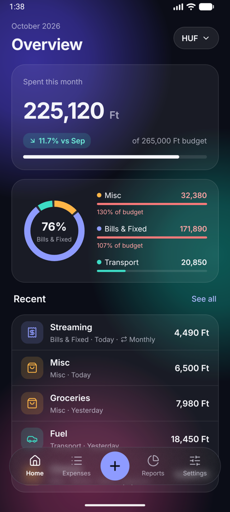
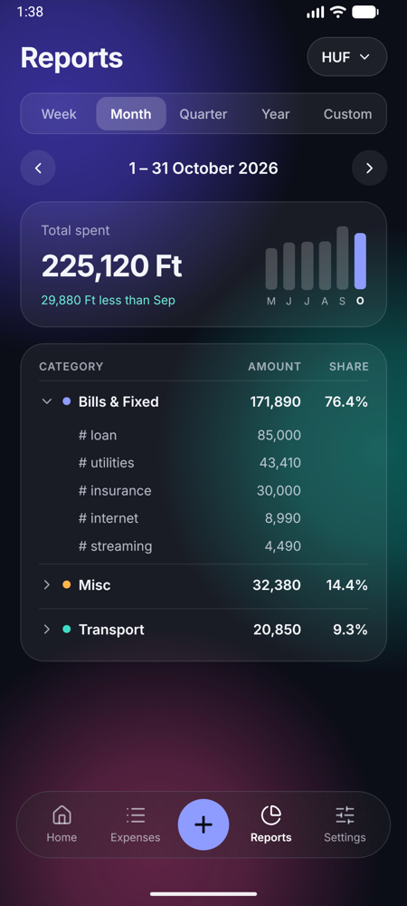

# Geldmeister X

A personal expense tracker for Android. Log what you spend in seconds, sort it into categories and tags, and see where your money goes each week, month, quarter or year. Everything stays on your phone: no account, no cloud, no ads.

<p align="center">
  
  &nbsp;&nbsp;
  
</p>

## Features

- **Quick add.** Tap **+**, type the amount on the keypad and save. Your default (starred) category is preselected; tags, currency, date and description are optional.
- **Overview.** This month's total, the change versus last month, a category split and budget progress.
- **Expenses list.** Grouped by day, with search and category filters. Tap to edit; swipe left to delete (with Undo).
- **Reports.** Week, month, quarter, year or a custom range. Totals per category, expandable to tags, laid out so you can copy the numbers into a spreadsheet by hand.
- **Categories and tags.** Fully customizable, with icons, colors and drag-to-reorder. Tags belong to a category (Transport → `fuel`, `parking`).
- **Recurring expenses.** Monthly or yearly items (rent, subscriptions, insurance) are added automatically when due. Missed ones are caught up the next time you open the app.
- **Budgets.** An optional monthly limit per category, with warnings when you go over.
- **Multiple currencies.** Pick which ones you track in Settings. Each has its own expenses, budgets and reports; amounts are never converted or mixed.
- **English and Hungarian.**

## Tech stack

| Area | Choice |
|---|---|
| Framework | [Expo](https://expo.dev) SDK 58 (React Native 0.88), TypeScript (strict) |
| Navigation | Expo Router (file-based routes in `src/app`) |
| Storage | SQLite (`expo-sqlite`) with [Drizzle ORM](https://orm.drizzle.team) and migrations |
| State | Zustand (settings, persisted locally) |
| i18n | i18next, react-i18next, expo-localization |
| UI | Custom components on the "Midnight Glass" design tokens; charts drawn with `react-native-svg` |
| Tests | Jest (`jest-expo`) for money, date-period and recurring-schedule logic |

The app targets Android for now, but the code avoids Android-only APIs so an iOS build stays possible.

## Requirements

- **Node.js 24 LTS** and npm
- **Android Studio** with the Android SDK and an emulator (or an Android phone with USB debugging)
- **JDK 17** for Gradle (point `JAVA_HOME` at it); this is the version the build is tested with
- `ANDROID_HOME` set to your SDK, with `platform-tools` and `emulator` on your `PATH`
- Optional: Watchman (faster file watching on macOS)

The app uses native modules, so it runs in its own **development build**. Expo Go is not enough.

## Getting started

```sh
git clone <repo-url> geldmeister-x
cd geldmeister-x
npm install

# Start an emulator from Android Studio (or plug in a phone), then:
npx expo run:android      # builds and installs the dev build, then starts Metro
```

The first build takes a few minutes. After that, day-to-day work is just:

```sh
npx expo start            # Metro with fast refresh; open the installed app
```

Run `npx expo run:android` again only when you add or update a library with native code. The `android/` folder is generated and not committed. After changing `app.json`, the app icon or the splash screen, regenerate it first with `npx expo prebuild -p android --clean`.

## Installing on your phone

1. On the phone, enable **Developer options** (tap *Build number* seven times in *About phone*), then turn on **USB debugging**.
2. Connect the phone by USB and accept the debugging prompt. `adb devices` should list it.
3. Install a **development build** (needs Metro running on your computer):
   ```sh
   npx expo run:android --device
   ```

Your data lives in the app's local database. Uninstalling the app deletes it.

## Release APK

The release build bundles the JavaScript and runs without your computer. It is installed directly from the APK (sideloaded), not through Google Play.

**Signing key (one-time).** Android only accepts an update signed with the same key as the installed app, so keep the key safe and backed up. Losing it means uninstalling, which deletes the data. Create a keystore outside the repo:

```sh
keytool -genkeypair -storetype PKCS12 -keystore ~/keystores/geldmeisterx-release.jks \
  -alias geldmeisterx -keyalg RSA -keysize 4096 -validity 10000
```

Then add its details to `~/.gradle/gradle.properties`:

```properties
GELDMEISTERX_RELEASE_STORE_FILE=/Users/<you>/keystores/geldmeisterx-release.jks
GELDMEISTERX_RELEASE_STORE_PASSWORD=...
GELDMEISTERX_RELEASE_KEY_ALIAS=geldmeisterx
GELDMEISTERX_RELEASE_KEY_PASSWORD=...
```

The config plugin `plugins/withReleaseSigning.js` wires these into the generated `android/` project on every prebuild.

**Each release:**

1. Increase `version` (for example `1.1.0`) and `android.versionCode` (by 1) in `app.json`. Android refuses an update with the same or a lower versionCode.
2. Build:
   ```sh
   npm run build:apk
   ```
   This runs a clean prebuild and writes the APK to `android/app/build/outputs/apk/release/app-release.apk`. It is built for 64-bit ARM (`arm64-v8a`) only, which covers current phones.
3. Install it. Updating over the installed app keeps your data.
   - **Over USB:** `adb install -r android/app/build/outputs/apk/release/app-release.apk`
   - **Without a cable:** copy the APK to the phone and open it. Allow "Install unknown apps" for the app you opened it from. If Play Protect warns that the app is unknown, choose to install anyway.

The phone's automatic backup (Google One) includes the app's database.

## Scripts

| Command | What it does |
|---|---|
| `npm run android` | Build and run the dev build (`expo run:android`) |
| `npm start` | Start Metro (`expo start`) |
| `npm run build:apk` | Build the signed release APK (see [Release APK](#release-apk)) |
| `npm test` | Run the unit tests |
| `npm run typecheck` | TypeScript check |
| `npm run lint` | ESLint (Expo config + Prettier) |
| `npm run format` | Format with Prettier |
| `npm run db:generate` | Generate a migration after changing `src/db/schema.ts` |

## Project structure

```
src/
  app/              Routes (Expo Router). Tabs, the Settings stack, and bottom sheets as modal routes
  features/         One folder per feature: components, hooks and queries
                    (expenses, home, reports, categories, recurring, budgets, currencies, settings)
  components/ui/    Shared design-system components (Screen, Card, Sheet, Button, …)
  db/               Drizzle schema, generated migrations, seed data, useQuery hook
  i18n/             en.json, hu.json and setup
  lib/              Pure helpers: money, dates, periods, recurring schedules (unit tested)
  theme/            Design tokens
assets/             App icon and splash images
plugins/            Expo config plugins (release signing)
docs/design/        Design reference: tokens, interaction rules, screen mockups, icon generator
```

## Data model

- Amounts are stored as **integer minor units** together with a currency code: HUF in whole forints, EUR and most others in cents.
- Rows use **UUID keys**, `created_at`/`updated_at` timestamps and **soft deletes** (`deleted_at`), so cloud sync can be added later without migrating identities.
- Migrations run automatically on app start. A fresh install is seeded with HUF and three starter categories (Bills & Fixed, Transport, Misc) with a few tags.

## Design

The UI follows the "Midnight Glass" design: dark, frosted-glass cards over soft color glows. Tokens, interaction rules and per-screen mockups are in [`docs/design/`](docs/design/README.md). A light theme isn't designed yet.

## License

[MIT](LICENSE)
